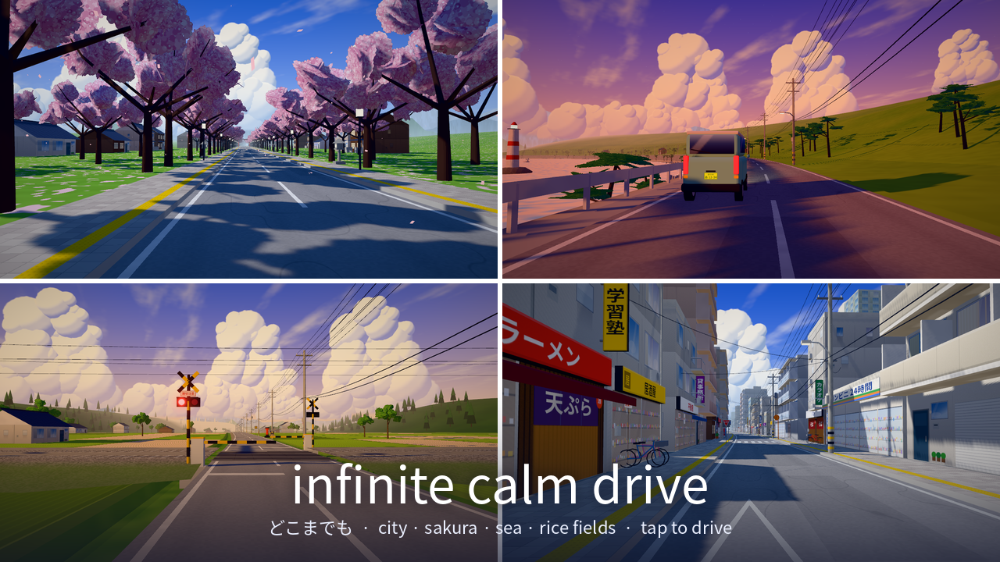

# Infinite Calm Drive

**▶ Play: https://ahmethuseyindok.github.io/infinite-calm-drive/**

An endless, calm drive through anime Japan. No destination, no traffic, no way to lose — the car drives itself.



## What you'll see

- **Six places that blend into each other and loop forever — a drive through the four seasons**: narrow city streets (街の灯), a cherry-blossom avenue in spring (桜並木), a summer coastal road (海沿いの道), rice-field countryside (田舎道), an autumn mountain pass (紅葉の峠) and snow country in winter (雪国).
- **Painted-background look**: cel-shaded buildings with blue-tinted shadows, towering cumulus painted on the GPU, bloom and sun streaks, kanji shop signs, power lines, vending machines, bicycles, crosswalks.
- **Level crossings (踏切)**: bells, flashing lamps and barrier arms; the car waits while a little commuter train rolls by.
- **Tunnels (トンネル)** through mountain ridges and coastal headlands: sodium lamps sweeping over the car, the echo of the road, and the bright world opening up again at the exit.
- **Day, night and weather**: golden hours, lit windows at night, overcast skies and gentle rain with wet roads, drifting cloud shadows on sunny days.
- **Generative ambience**: a slow pad, soft bells, road hum, waves by the sea, cicadas in the fields, rain on the roof.

## Controls

| | |
|---|---|
| Steer | ← → or touch the left / right side |
| Speed | ↑ ↓ or drag up / down |
| ◐ / `C` | camera: chase · low angle · eye level (no car) · 🎬 cinematic |
| ⛅ / `R` | weather: auto · clear · cloudy · rain |
| ♪ / `M` | sound on / off |
| ☼ / `T` | pause the time of day |

Let go and it drives itself again after a few seconds.

## Playable inside a post

The page carries an X `player` card, so a post linking to the play URL shows the game playable inline
(`?embed=1` is the in-post player: lighter quality, compact UI, tap to start).

## URL parameters

`?env=city|sakura|coast|country|mountain|snow` start zone · `&t=0..1` time of day · `&weather=clear|cloudy|rain` ·
`&cam=low|eye` · `&q=low|mid|high` quality · `&seed=` world seed.

## Build

```sh
npm install
npm run build        # → dist/game.js
python3 -m http.server   # any static server
```

Everything is procedural — no image or model assets. Built with [three.js](https://threejs.org).
The original Canvas2D prototype is still at [`classic.html`](classic.html).
